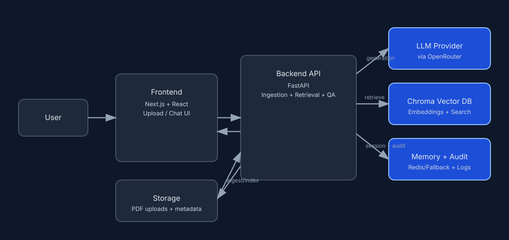

# DocTongue
 
## Table of Contents

- [1) Project Description](#1-project-description)
- [2) Setup (Containerization + ENV)](#2-setup-containerization--env)
- [3) Architecture](#3-architecture)
- [4) Moving to Production on Hyper-Scalers (AWS / GCP / Azure / Cloudflare)](#4-moving-to-production-on-hyper-scalers-aws--gcp--azure--cloudflare)
- [5) RAG/LLM Approach and Decisions](#5-ragllm-approach-and-decisions)
- [6) Technical Decisions Taken](#6-technical-decisions-taken)
- [7) How Coding Agent (GitHub Copilot) Was Used](#7-how-coding-agent-github-copilot-was-used)
- [8) What We'd Do Differently With More Time](#8-what-wed-do-differently-with-more-time)
- [9) Screenshots and Example Video](#9-screenshots-and-example-video)
- [10) Licence](#10-licence)

## 1) Project Description

DocTongue is a full-stack Retrieval-Augmented Generation (RAG) application for document question answering.

- Users upload PDF files.
- The system indexes document chunks into a vector store.
- Users ask questions in chat.
- The assistant answers with grounded citations from uploaded documents.

## 2) Setup (Containerization + ENV)

### Prerequisites

- Docker Engine (with Docker Compose plugin).
- Ports `3000` and `8000` available on your machine.

### Create ENV file

Copy [backend/.env.example](backend/.env.example) to `backend/.env`, then set at least:

```env
LLM_PROVIDER=stub
EMBEDDING_PROVIDER=local
LLM_MODEL=openai/gpt-4o-mini
EMBEDDING_MODEL=nvidia/nemotron-3.5-embed-8b:free
QUALITY_CONTROL_ENABLED=0
REDIS_URL=redis://localhost:6379/0
```

Notes:

- `stub` + `local` works without external API keys.
- Answers are generated through [OpenRouter](https://openrouter.ai). To use a real
  model, set `LLM_PROVIDER=openrouter`, `OPENROUTER_API_KEY=sk-or-...`, and an
  OpenRouter model slug in `LLM_MODEL` (for example `openai/gpt-4o-mini`,
  `anthropic/claude-3.5-sonnet`, or `meta-llama/llama-3.3-70b-instruct`).
- Embeddings go through the same OpenRouter key. Set
  `EMBEDDING_PROVIDER=openrouter` and an embedding slug in `EMBEDDING_MODEL`;
  `nvidia/nemotron-3.5-embed-8b:free` is free and multilingual. Keep
  `EMBEDDING_PROVIDER=local` for the zero-key hash fallback.
- Queries and documents are embedded with different `input_type` hints
  (`search_query` / `search_document`), which asymmetric models such as
  Nemotron require for correct retrieval. Set `EMBEDDING_INPUT_TYPE=0` for
  endpoints that reject the field.
- `EMBEDDING_DIMENSIONS` truncates the returned vector. Nemotron 3.5 Embed 8B
  is natively 4096-dim and supports truncation; if a model ignores the request
  the backend fails fast with the width it actually returned.
- `OPENAI_API_KEY` is only needed for the optional `deepeval` judge when
  `QUALITY_CONTROL_ENABLED=1`.
- See [backend/.env.example](backend/.env.example) for every variable, grouped by section.

### Start containers

From the project root:

```bash
docker compose up --build
```

Run detached:

```bash
docker compose up --build -d
```

Check status:

```bash
docker compose ps
```

Check logs:

```bash
docker compose logs -f
```

Stop:

```bash
docker compose down
```

### How to access the app

- Frontend UI: http://localhost:3000
- Backend API docs (Swagger): http://localhost:8000/docs
- Backend health endpoint: http://localhost:8000/health

Usage flow:

1. Open the frontend URL.
2. Upload one or more PDF files from the left panel.
3. Wait for indexing to finish.
4. Ask questions in the chat panel.
5. Review returned citations with each answer.


## 3) Architecture

High-level components:

- `frontend/`: Next.js UI for upload, document list, and chat.
- `backend/`: FastAPI APIs for ingestion, retrieval, and answer generation.
- `backend/data/chroma/`: local vector persistence.
- `backend/data/uploads/`: uploaded PDFs.

Architecture diagram (SVG):



## 4) Moving to Production on Hyper-Scalers (AWS / GCP / Azure / Cloudflare)

Key considerations before production rollout:

- **Identity and secrets**: Use managed identity/IAM roles and secret stores (Azure Key Vault / AWS Secrets Manager) instead of static secrets in files.
- **Storage hardening**: Move uploads and artifacts to object storage (Azure Blob / AWS S3) lifecycle policies, and backups.
- **Vector database**: Use a managed vector store.
- **Networking and security**: Use private networking, TLS.
- **Observability**: Centralize logs, traces.
- **Scalability and reliability**: Add autoscaling for API/workers, queue-based ingestion for large files.
- **Compliance and governance**: Define data retention, residency, recovery and backup.


## 5) RAG/LLM Approach and Decisions

| Area | Choices considered | Final choice and why |
|---|---|---|
| LLM provider | Direct SDK integration per provider vs a single multi-model gateway. | **OpenRouter** via a thin in-house `httpx` wrapper: one key and one OpenAI-compatible endpoint serve both chat and embeddings across many vendors, and models can change through ENV with no code changes. |
| Embedding model | Local deterministic embedding vs hosted embedding APIs. | **Configurable embeddings** through the same OpenRouter gateway, defaulting to the free `nvidia/nemotron-3.5-embed-8b:free`; local hash embedding remains available for no-key local development. Queries and documents are tagged with distinct `input_type` hints because the model is asymmetric. |
| Vector database | In-memory index, self-hosted vector DB, or managed vector DB. | **Chroma (local persistent)** for simple setup and fast iteration in this project scope. |
| Orchestration framework | Full agent framework vs direct service orchestration in backend code. | **Direct orchestration in FastAPI services** for lower complexity and easier debugging in a small codebase. |
| Chunking strategy | Semantic chunking vs fixed-size chunking with overlap. | **Fixed-size + overlap** chosen for simplicity, predictable behavior, and straightforward tuning. |
| Retrieval strategy | Dense-only retrieval vs hybrid retrieval and reranking. | **Vector top-k + lightweight grounding filters** implemented now for a simple and stable baseline. |
| Prompt & context management | Stateless prompt only vs session-aware reformulation and memory. | **Grounded system prompt + sliding window memory** to keep answers citation-based while improving follow-up query resolution. |
| Guardrails | No input filter vs explicit pre-check policy layer. | **Input guardrails enabled** for prompt-injection patterns and explicit sexual content at the `/api/chat` boundary. |
| Quality control | No judge, heuristic-only, or LLM-as-judge with fallback. | **Optional `deepeval` LLM-as-judge using `AnswerRelevancyMetric`**, with a deterministic lexical-overlap fallback so the chat path never fails because the judge is unavailable. |
| Observability | Console-only logs vs structured logs + audit artifacts. | **Application logging + chat audit file** for runtime diagnostics and future auditing workflows. |

### Response evaluation metric

Answer quality is currently scored by a single metric: **`AnswerRelevancyMetric`
from [`deepeval`](https://github.com/confident-ai/deepeval)**, applied per answer
in [`ResponseQualityEvaluator`](backend/app/services/quality_control.py).

| Aspect | Detail |
|---|---|
| Metric | `deepeval.metrics.AnswerRelevancyMetric` (LLM-as-judge) |
| Test case | `LLMTestCase(input=question, actual_output=answer, retrieval_context=contexts)` |
| Threshold | `QUALITY_CONTROL_THRESHOLD` (default `0.5`); `passed = score >= threshold` |
| Enabled by | `QUALITY_CONTROL_ENABLED` (off by default) |
| Judge credentials | `OPENAI_API_KEY` — deepeval resolves its own judge model, independently of `LLM_PROVIDER` |
| Reported as | `method="deepeval.answer_relevancy"`, with the judge's rationale when `QUALITY_CONTROL_INCLUDE_REASON=1` |

Behaviour in the two non-primary paths:

- **Fallback.** If deepeval is not installed or the judge call fails, and
  `QUALITY_CONTROL_FAIL_OPEN=1`, the score falls back to a deterministic
  lexical-overlap heuristic reported as `method="fallback.lexical_overlap"`.
  With `QUALITY_CONTROL_FAIL_OPEN=0` the error propagates instead.
- **Skipped.** Answers that are both ungrounded and have no retrieved context
  are not scored, to avoid penalising the explicit "no evidence found"
  response. These are reported as `method="skipped"` with a score of `0.0`.

Scope note: `AnswerRelevancyMetric` scores how well the answer addresses the
question. It is not a groundedness or hallucination check — faithfulness to the
retrieved sources is handled separately by the citation and grounding filters in
the retrieval path. Adding a faithfulness metric would mean a second deepeval
metric alongside this one.

## 6) Technical Decisions Taken

Current simple decisions:

- Next.js + FastAPI split for clear frontend/backend boundaries and independent scaling.
- Chroma local persistence for quick local development and zero-extra infrastructure.
- OpenRouter gateway behind a thin local wrapper, keeping models swappable without coupling business logic to a vendor SDK.
- Guardrails + optional quality control path to improve safety and answer reliability; evaluation currently uses deepeval's `AnswerRelevancyMetric` with a lexical-overlap fallback.

Engineering standards document:

- [ENGINEERING_STANDARDS.md](ENGINEERING_STANDARDS.md)

## 7) How Coding Agent (GitHub Copilot) Was Used

GitHub Copilot was used as a coding assistant for:

- scaffolding and refactoring support,
- faster iteration on UI and backend integration,
- generating baseline tests and improving developer throughput.

All generated output was reviewed and adjusted manually before acceptance.

## 8) What We'd Do Differently With More Time

- Implement user authentication / authoriztaion.
- Better citation UX (page-level and highlighted spans).
- Cloud-native deployment templates (Azure/AWS).

## 9) Screenshots and Example Video

Screenshot(s):

- Main dashboard: 

<video controls src="assets/simplescreenrecorder-2026-07-22_15.30.13.mp4"></video>

If embedded playback is unsupported, open: [Demo video](assets/simplescreenrecorder-2026-07-22_15.30.13.mp4)

## 10) Licence

MIT License - Use as a template for your own rag applications!

