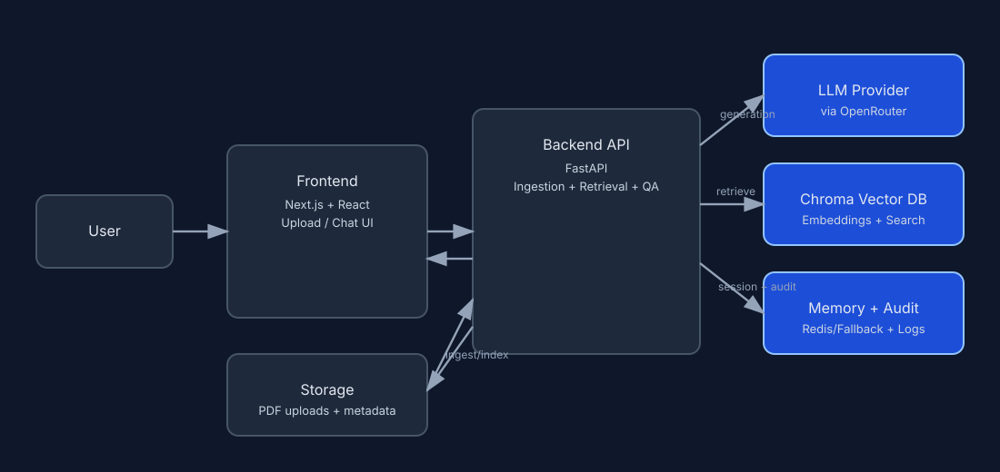

# DocTongue
 
## Table of Contents

- [1) Project Description](#1-project-description)
- [2) Setup (Containerization + ENV)](#2-setup-containerization--env)
- [3) Architecture](#3-architecture)
- [4) Moving to Production on Hyper-Scalers (AWS / GCP / Azure / Cloudflare)](#4-moving-to-production-on-hyper-scalers-aws--gcp--azure--cloudflare)
- [5) RAG/LLM Approach and Decisions](#5-ragllm-approach-and-decisions)
- [6) Technical Decisions Taken](#6-technical-decisions-taken)
- [7) How Coding Agent (GitHub Copilot) Was Used](#7-how-coding-agent-github-copilot-was-used)
- [8) What We'd Do Differently With More Time](#8-what-wed-do-differently-with-more-time)
- [9) Screenshots and Example Video](#9-screenshots-and-example-video)
- [10) Licence](#10-licence)

## 1) Project Description

DocTongue is a full-stack Retrieval-Augmented Generation (RAG) application for document question answering.

- Users upload PDF files.
- The system indexes document chunks into a vector store.
- Users ask questions in chat.
- The assistant answers with grounded citations from uploaded documents.

## 2) Setup (Containerization + ENV)

### Prerequisites

- Docker Engine (with Docker Compose plugin).
- Ports `3000` and `8000` available on your machine.

### Create ENV file

Copy [backend/.env.example](backend/.env.example) to `backend/.env`, then set at least:

```env
LLM_PROVIDER=stub
EMBEDDING_PROVIDER=local
LLM_MODEL=openai/gpt-4o-mini
EMBEDDING_MODEL=nvidia/nemotron-3.5-embed-8b:free
REDIS_URL=redis://localhost:6379/0
```

Notes:

- `stub` + `local` works without external API keys.
- Answers are generated through [OpenRouter](https://openrouter.ai). To use a real
  model, set `LLM_PROVIDER=openrouter`, `OPENROUTER_API_KEY=sk-or-...`, and an
  OpenRouter model slug in `LLM_MODEL` (for example `openai/gpt-4o-mini`,
  `anthropic/claude-3.5-sonnet`, or `meta-llama/llama-3.3-70b-instruct`).
- Embeddings go through the same OpenRouter key. Set
  `EMBEDDING_PROVIDER=openrouter` and an embedding slug in `EMBEDDING_MODEL`;
  `nvidia/nemotron-3.5-embed-8b:free` is free and multilingual. Keep
  `EMBEDDING_PROVIDER=local` for the zero-key hash fallback.
- Queries and documents are embedded with different `input_type` hints
  (`search_query` / `search_document`), which asymmetric models such as
  Nemotron require for correct retrieval. Set `EMBEDDING_INPUT_TYPE=0` for
  endpoints that reject the field.
- `EMBEDDING_DIMENSIONS` truncates the returned vector. Nemotron 3.5 Embed 8B
  is natively 4096-dim and supports truncation; if a model ignores the request
  the backend fails fast with the width it actually returned.
- `EVAL_JUDGE_ENABLED=1` turns on the optional LLM-as-judge metrics in the
  offline evaluation harness. The judge runs through OpenRouter on
  `EVAL_JUDGE_MODEL`, so no separate `OPENAI_API_KEY` is required.
- See [backend/.env.example](backend/.env.example) for every variable, grouped by section.

### Start containers

From the project root:

```bash
docker compose up --build
```

Run detached:

```bash
docker compose up --build -d
```

Check status:

```bash
docker compose ps
```

Check logs:

```bash
docker compose logs -f
```

Stop:

```bash
docker compose down
```

### How to access the app

- Frontend UI: http://localhost:3000
- Backend API docs (Swagger): http://localhost:8000/docs
- Backend health endpoint: http://localhost:8000/health

Usage flow:

1. Open the frontend URL.
2. Upload one or more PDF files from the left panel.
3. Wait for indexing to finish.
4. Ask questions in the chat panel.
5. Review returned citations with each answer.


## 3) Architecture

High-level components:

- `frontend/`: Next.js UI for upload, document list, and chat.
- `backend/`: FastAPI APIs for ingestion, retrieval, and answer generation.
- `backend/data/chroma/`: local vector persistence.
- `backend/data/uploads/`: uploaded PDFs.

Architecture diagram (SVG):



## 4) Moving to Production on Hyper-Scalers (AWS / GCP / Azure / Cloudflare)

Key considerations before production rollout:

- **Identity and secrets**: Use managed identity/IAM roles and secret stores (Azure Key Vault / AWS Secrets Manager) instead of static secrets in files.
- **Storage hardening**: Move uploads and artifacts to object storage (Azure Blob / AWS S3) lifecycle policies, and backups.
- **Vector database**: Use a managed vector store.
- **Networking and security**: Use private networking, TLS.
- **Observability**: Centralize logs, traces.
- **Scalability and reliability**: Add autoscaling for API/workers, queue-based ingestion for large files.
- **Compliance and governance**: Define data retention, residency, recovery and backup.


## 5) RAG/LLM Approach and Decisions

| Area | Choices considered | Final choice and why |
|---|---|---|
| LLM provider | Direct SDK integration per provider vs a single multi-model gateway. | **OpenRouter** via a thin in-house `httpx` wrapper: one key and one OpenAI-compatible endpoint serve both chat and embeddings across many vendors, and models can change through ENV with no code changes. |
| Embedding model | Local deterministic embedding vs hosted embedding APIs. | **Configurable embeddings** through the same OpenRouter gateway, defaulting to the free `nvidia/nemotron-3.5-embed-8b:free`; local hash embedding remains available for no-key local development. Queries and documents are tagged with distinct `input_type` hints because the model is asymmetric. |
| Vector database | In-memory index, self-hosted vector DB, or managed vector DB. | **Chroma (local persistent)** for simple setup and fast iteration in this project scope. |
| Orchestration framework | Full agent framework vs direct service orchestration in backend code. | **Direct orchestration in FastAPI services** for lower complexity and easier debugging in a small codebase. |
| Chunking strategy | Semantic chunking vs fixed-size chunking with overlap. | **Fixed-size + overlap** chosen for simplicity, predictable behavior, and straightforward tuning. |
| Retrieval strategy | Dense-only retrieval vs hybrid retrieval and reranking. | **Vector top-k + lightweight grounding filters** implemented now for a simple and stable baseline. |
| Prompt & context management | Stateless prompt only vs session-aware reformulation and memory. | **Grounded system prompt + sliding window memory** to keep answers citation-based while improving follow-up query resolution. |
| Guardrails | No input filter vs explicit pre-check policy layer. | **Input guardrails enabled** for prompt-injection patterns and explicit sexual content at the `/api/chat` boundary. |
| Evaluation | Per-answer judge in the request path vs an offline run over a ground-truthed test set. | **Offline evaluation on a fixed test set**, because a per-answer judge has no ground truth and so cannot detect retrieval of the wrong document — the dominant failure in document QA. |
| Observability | Console-only logs vs structured logs + audit artifacts. | **Application logging + chat audit file** for runtime diagnostics and future auditing workflows. |

### Response evaluation

Answer quality is measured **offline, against a fixed ground-truthed test set**,
not per answer inside the request path. A per-answer relevancy judge has no
ground truth, so it cannot see the failure that dominates document QA:
retrieving the *wrong* document and answering confidently from it. An answer
quoting the Premium deductible in response to a question about the Standard plan
scores highly on answer-relevancy and is completely wrong.

The harness lives in [backend/app/evaluation](backend/app/evaluation) and is run
from the `backend` directory:

```bash
python -m app.evaluation.run              # deterministic metrics only, no API key
EVAL_JUDGE_ENABLED=1 python -m app.evaluation.run   # adds LLM-as-judge metrics
```

Results are written to `data/evaluations/{run_id}.json`.

**First try.** The baseline runs are kept in
[docs/evaluation-runs/first-try](docs/evaluation-runs/first-try) — the result
documents, the exact corpus PDFs that were indexed, the test set as it stood, and
a visual dashboard. On that baseline the pipeline scores 100% source hit rate,
1.000 mean reciprocal rank and 100% refusal accuracy over 15 cases.

That folder's [README](docs/evaluation-runs/first-try/README.md) records what the
runs surfaced, which was mostly defects in the harness itself:

- A refusal detector that matched only the pipeline's canned strings, so correct
  model refusals scored as failures.
- A provider timeout scored as a refusal, rather than as the third state it is.
- `hash()`-based local embeddings being unstable across processes, which made any
  persisted index unmatchable after a restart.
- **The judge tier is not yet trustworthy.** Of four sub-perfect judge scores,
  three were judge errors that contradicted the supplied ground truth, and none
  found a real defect. Treat `faithfulness` and `answer_relevancy` as unproven
  until re-run against a stronger judge model; the deterministic metrics are the
  signal.
- Still open: the grounding filter admits irrelevant chunks and reports
  `grounded: true` regardless. Unfixed, since it affects the live chat path and
  deserves its own before/after run against this baseline.

**Corpus.** Four fictional ShieldCare insurance PDFs, generated by
[generate_corpus.py](backend/app/evaluation/corpus/generate_corpus.py) with no
third-party dependency. Three are structurally identical and differ only in
their values, so a question like "what is the deductible?" matches all three
almost equally on lexical overlap — answering it correctly requires the
retrieval layer to actually discriminate. The fourth is a comparison table laid
out with absolute text positioning, which is how real PDFs encode tables and
which reproduces the extraction mangling chunking has to cope with.

**Test set.** [testset.json](backend/app/evaluation/testset.json) holds 15 cases
covering confusable per-plan lookups, cross-document questions, table lookups, a
paraphrase with no lexical overlap, and three negatives whose answers are absent
from the corpus — where the correct behaviour is a refusal.

| Tier | Metrics | Cost |
|---|---|---|
| **Deterministic** (always runs) | `source_hit` / hit rate, MRR, refusal accuracy, grounded rate, citation count, latency | None — no LLM involved, so it runs under `stub`/`local` in CI |
| **LLM-as-judge** (opt-in) | `AnswerRelevancyMetric`, `FaithfulnessMetric`, `ContextualPrecisionMetric`, `ContextualRecallMetric` | ~8 API calls per case, ~85% of a run's token spend |

The deterministic tier is the primary regression signal: it needs no key, is
fully reproducible, and catches wrong-document retrieval directly. Judge metrics
are scored in a single batched `evaluate()` call through
[eval_judge.py](backend/app/services/eval_judge.py), which routes deepeval
through OpenRouter so one key covers both answering and evaluation. When the
judge is disabled or unavailable, every metric is recorded as `skipped` **with a
reason** rather than silently falling back to a weaker score.

The judge needs a model that returns schema-valid JSON reliably under
concurrency. `EVAL_JUDGE_MODEL` defaults to a free model, which in practice
failed twice — once on the free-tier daily cap, once on timeouts — and then
produced three false-positive findings when it did run. Set it to a stronger
model before relying on judge scores.

Every result snapshots `retrieval_k`, `chunk_size`, `chunk_overlap` and the
model/provider pair it ran under; without that, two runs are not comparable and
a fixed test set buys nothing.

Negative cases are excluded from the retrieval rates and from the judge: a
negative that correctly cites nothing would otherwise drag the hit rate down for
behaving exactly as intended, and contextual recall against a refusal is
meaningless. Their correctness is captured by `refusal_accuracy`.

## 6) Technical Decisions Taken

Current simple decisions:

- Next.js + FastAPI split for clear frontend/backend boundaries and independent scaling.
- Chroma local persistence for quick local development and zero-extra infrastructure.
- OpenRouter gateway behind a thin local wrapper, keeping models swappable without coupling business logic to a vendor SDK.
- Guardrails at the `/api/chat` boundary for safety; answer quality is measured offline against a ground-truthed test set rather than scored per answer in the request path.

Engineering standards document:

- [ENGINEERING_STANDARDS.md](ENGINEERING_STANDARDS.md)

## 7) How Coding Agent (GitHub Copilot) Was Used

GitHub Copilot was used as a coding assistant for:

- scaffolding and refactoring support,
- faster iteration on UI and backend integration,
- generating baseline tests and improving developer throughput.

All generated output was reviewed and adjusted manually before acceptance.

## 8) What We'd Do Differently With More Time

- Implement user authentication / authoriztaion.
- Better citation UX (page-level and highlighted spans).
- Cloud-native deployment templates (Azure/AWS).

## 9) Screenshots and Example Video

Screenshot(s):

- Main dashboard: 

<video controls src="assets/simplescreenrecorder-2026-07-22_15.30.13.mp4"></video>

If embedded playback is unsupported, open: [Demo video](assets/simplescreenrecorder-2026-07-22_15.30.13.mp4)


## 10) TODO LIST


1. Add more evaluation metrices
2. Implement offline with golden set of questions, and online evaluation sets and create a CI/CD Pipeline 
3. Implement observablitiy framework for online evaluation
4. Implement local / On-Permise Version for internal data

## 11) Licence

MIT License - Use as a template for your own rag applications!

